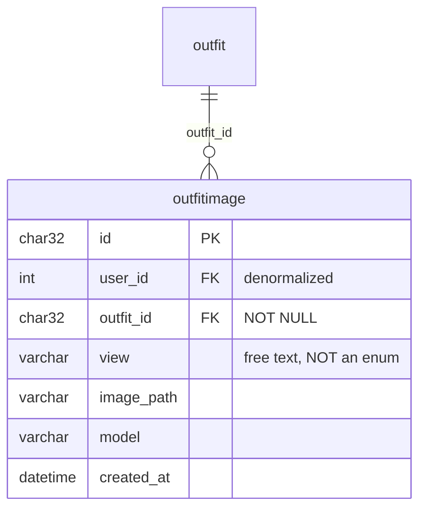
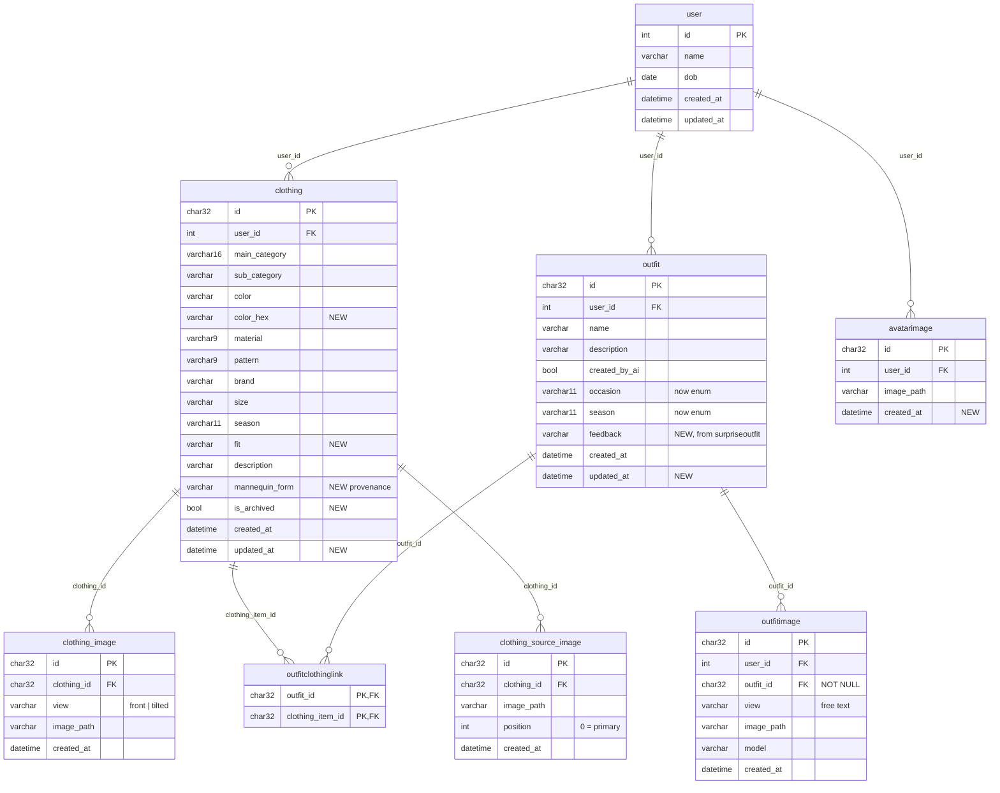

# Closet Muse — Database Audit & Persistence Plan

> **Purpose:** a self-contained handoff document. A new Copilot session should be able to
> read only this file and continue the work without re-deriving the analysis.
>
> **Status:** PLAN — Phase 1 implemented and verified (2026-11-11). Phase 2 (Alembic)
> implemented and verified (2026-11-14). Phases 2b+ not started.
> **Audit date:** 2026-11-10, revised 2026-11-11, revised 2026-11-14 (Alembic adopted).

---

## 1. Non-negotiable constraints

These were explicitly decided by the user. **Do not revisit them.**

| Constraint | Detail |
| --- | --- |
| **Single-user local** | `user` stays a 1-row seed table. No auth, no email uniqueness, no multi-user planning. `user_id=1` is hardcoded in the frontend. |
| **Alembic owns the schema** | *Reversed 2026-11-14 — this row used to say "NO Alembic".* Alembic with an explicit `make migrate` target; `create_all()` is removed from the lifespan and `seed.py`. Nothing migrates on app start — `make migrate` is a Makefile prerequisite, and on a current DB it is a single `SELECT` against `alembic_version`. See Phase 2. |
| **`GeneratedImage` → `OutfitImage`** | Rename the table/model. Verified blast radius is 2 references. Table has 0 rows, so DROP + CREATE is safe — no data migration. |
| **`OutfitImage` has NO ordering column** | `view_order` was proposed and rejected. The frontend fetches all views and decides display order itself. Do not re-add an ordering column. |
| **`OutfitImage` drops these columns** | `latency_ms`, `seed`, `kind`, `aspect_ratio`, `prompt`, `view_order`. |
| **Wire up outfit history** | `Outfit` + `OutfitClothingLink` + `OutfitImage` must be written by the try-on flow. |
| **Clothing images live in child tables** | Polished output moves out of `clothing.image_path` / `image_path_tilted` into `clothing_image`; the user's source photos go in `clothing_source_image`. **Two tables, not one with a `kind` discriminator** — they have different shapes (`view` vs `position`) and different lifecycles. |

---

## 2. Current state — 8 tables, 3 genuinely live

All tables are defined in `src/closet_muse/db/models.py`.

| Table | Written by | Read by | Status |
| --- | --- | --- | --- |
| `user` | `seed.py`, `POST /users/` | `GET /users/{id}`, all FKs | ✅ LIVE |
| `clothing` | `POST /clothing/{user_id}` | list/counts/get/patch/delete, `/outfits/generate` | ✅ LIVE |
| `avatarimage` | `POST /users/{id}/avatar/` | `GET /users/{id}/avatar/` | ⚠️ API-only, no UI caller |
| `outfit` | **nothing** | `GET /outfits/{id}` only | ❌ DEAD |
| `outfitclothinglink` | **nothing** | `DELETE /clothing/item` (cleanup only) | ❌ DEAD |
| `generatedimage` | **nothing** | **nothing** | ❌ DEAD → rename |
| `surpriseoutfit` | **nothing** | **nothing** | ❌ DEAD |
| `bodyprofile` | **nothing** (only updated *if it already exists*) | avatar sync in `users.py` | ❌ DEAD (unreachable) |

### Purpose of each table (for context)

- **`user`** — the wardrobe owner. Holds `name` + `dob` only. A placeholder so `user_id=1` has a target.
- **`clothing`** — the wardrobe. One row per garment: `main_category` (enum name), optional `sub_category`, `color`, `material`, `pattern`, `brand`, `size`, `season`, `description`, plus two image filenames (front + three-quarter mannequin views) that Phase 7 moves into `clothing_image`. The only table with complete CRUD.
- **`avatarimage`** — history of uploaded avatar photos, one row per upload. Complete API, but unused by the UI and missing `created_at`.
- **`outfit`** — intended as a saved combination of garments. Never written; the only reader always 404s.
- **`outfitclothinglink`** — M:N join declaring which garments form an outfit. Never written.
- **`generatedimage`** — intended as the record of each AI-rendered image. Never written.
- **`surpriseoutfit`** — intended for the "Surprise Me" feature. Its consumer is a `pass` stub.
- **`bodyprofile`** — intended body measurements. Unreachable dead code, superseded by the generated model images in `assets/avatar/` + `settings.model_image_views`.

---

## 3. Current ER diagram (as built)

---

## 4. Findings

### Critical
1. **Orphaned files.** `POST /outfits/generate` calls `storage.save_image(...)` for each of 3 model views and **discards the returned filename**. Result: 47 orphan PNGs in `var/storage/generated/` with zero DB rows. No history, no re-view, no garbage collection.
2. **`create_all()` cannot add columns.** Every new field currently needs a manual `ALTER TABLE` or `make clean`. This is the #1 friction source and blocks every subsequent phase. **Resolved by adopting Alembic** — see Phase 2.

### Correctness
3. **No FK enforcement.** SQLite defaults to `PRAGMA foreign_keys=OFF` and nothing turns it on, so all `REFERENCES` clauses are decorative. That's why `delete_clothing_item` hand-deletes link rows.
4. **No indexes** except PK autoindexes. `outfitclothinglink`'s PK is `(outfit_id, clothing_item_id)`, so the delete path filtering on `clothing_item_id` full-scans. Every `WHERE user_id = ?` full-scans.
5. **No WAL / `busy_timeout`.** `check_same_thread=False` is set, but concurrent Streamlit + FastAPI writes can still hit `database is locked`.
6. **`AvatarImage` has no `created_at`** → `GET /users/{id}/avatar/` uses `avatar[-1]`, relying on rowid order.
7. **`BodyProfile` sync in `users.py` is unreachable** — it does `select(...).first()` then writes only `if profile is not None`, which is never true since no endpoint creates a row.

### Modeling
8. **`Outfit.occasion` / `Outfit.season` are free-text `Optional[str]`** while `enums.Occasion` and `enums.Season` already exist and are unused.
9. **`User.dob` is `datetime`**, should be `date`. No `updated_at` on any table.
10. **`Clothing` gaps:** no `updated_at`, `is_archived`, `color_hex` (the docstring mentions hex), `fit`, or provenance (`mannequin_form`).
11. **Source upload photos are discarded** — `POST /images/polish/` reads the uploads into memory, sends them to OpenRouter, and drops them. Only the polished mannequin images survive, so the user's original photos are gone forever and an item can never be re-polished with a different mannequin form. Fixed by Phase 7.
12. **"Surprise Me" is unimplemented** — `generate_surprise_outfit()` in `frontend/views/generate_outfit.py` is a literal `pass` stub.

### Observation
13. **Enum columns store the enum *name*** (`VARCHAR(16)` → `"ONE_PIECE"`, `VARCHAR(9)` → `"POLYESTER"`, `VARCHAR(11)` → `"ALL_SEASONS"`). Fine, but raw SQL and any future analytics see names, not `.value`. Document it.
14. **`response.json()["usage"]` is available and thrown away** in the notebook — free token/cost telemetry that is currently discarded. (Noted, not planned.)

---

## 5. Target schema

### Verdicts

| Table | Verdict | Reason |
| --- | --- | --- |
| `user` | **Keep, fix** | Retype `dob` to `date`; add `updated_at`. |
| `clothing` | **Keep, extend** | Add `updated_at`, `color_hex`, `fit`, `is_archived`, `mannequin_form`; move `image_path` / `image_path_tilted` into `clothing_image`. |
| `outfit` | **Keep, wire up** | Retype `occasion`/`season` to enums; add `feedback`, `updated_at`. |
| `outfitclothinglink` | **Keep, wire up** | Add `ON DELETE CASCADE` + index on `clothing_item_id`. |
| `outfitimage` | **Rename + wire up** | From `generatedimage`. New column set (below). |
| `surpriseoutfit` | **DROP** | Its `feedback` field moves to `outfit`. |
| `bodyprofile` | **DROP (defer)** | Unreachable. Re-add when personalization is real. |
| `avatarimage` | **Keep, fix** | Add `created_at`; order by it. |
| `clothing_image` | **ADD (required)** | Polished output, moved out of `clothing.image_path` / `image_path_tilted`. One row per view. |
| `clothing_source_image` | **ADD (required)** | The user's uploaded photos, currently discarded. Enables re-polishing later. |

### `OutfitImage` — final shape

**Seven columns.** This is settled; do not add back what was removed.

**Kept:** `id`, `user_id`, `outfit_id`, `view`, `image_path`, `model`, `created_at`.

**Removed by user, with rationale:**
- `prompt` — `_build_tryon_prompt()` derives it deterministically from the linked clothing rows, so it is reconstructible. *Trade-off:* editing or deleting a garment permanently loses the ability to reproduce that historical look exactly. Accepted, because this is history, not a regeneration feature.
- `seed`, `aspect_ratio` — global `settings` values, not per-row facts.
- `kind` — `OutfitImage` is try-on only. Polish output is persisted in `clothing_image` (Phase 7), a different table, so no discriminator is needed here.
- `view_order` — the frontend fetches all views and decides order itself.

**Kept deliberately — `model`:** `settings.image_model_tryon` changes over time, so the model that actually rendered a row **cannot** be re-derived later. Cheapest possible provenance; this is the one field that must persist.

**Constraints:**
- `outfit_id` is `NOT NULL` — an "outfit image" with no outfit is a contradiction.
- `UNIQUE(outfit_id, view)` — one image per view per outfit. Guards against a retry or double-submit silently creating duplicate `center` images, which is a realistic failure mode given the current code path writes files with no DB guard.
- Indexes on `(user_id)` and `(outfit_id)`.

### Why `view` is free text, not an enum

The views are already config-driven: `settings.model_image_views` is `{"left": ..., "center": ..., "right": ...}` — arbitrary string keys mapping to file paths. Nothing in the DB needs to know that `left` means anything.

This mirrors the existing `clothing.sub_category` precedent (`Optional[str]` precisely so adding a sub-category needs no migration — see `/memories/repo/categories.md`). Adding `back`, `closeup`, `detail`, or `side` tomorrow means updating the settings dict and nothing else.

**No lookup table.** A `view` table only earns its keep when the set of views is *user-managed* data — uploadable, renameable, per-user. Yours is a fixed developer-curated set that ships with the code. A table would add a join and an insert-on-startup for no benefit.

### Ordering without `view_order` — implement in the frontend

`SELECT * FROM outfitimage WHERE outfit_id = ?` returns rows in **no guaranteed order**. Since `UNIQUE(outfit_id, view)` guarantees one row per view, the frontend already has what it needs:

1. Fetch rows, index them into a dict by `view`.
2. Iterate `settings.model_image_views` in its declared order, pulling matching rows.
3. Append any row whose `view` isn't in that dict (a newly added view, or one since removed from settings).

This is the **same pattern `display_look_panel()` already uses** — it does `names = [name for name in view_names if name in generated]` then `names = names or list(generated)` as fallback. The existing carousel logic survives the switch from in-memory ZIP to DB rows with almost no change.

### Target ER diagram

---

## 6. Implementation plan

Execute in order. Phase 1 is done. Phase 2 (Alembic scaffold + baseline) is the
prerequisite for every later phase, because after it the schema is owned by revisions rather
than `create_all()`.

### Phase 1 — Engine hardening *(no schema change; unblocks all later phases)* — ✅ DONE

**File:** `src/closet_muse/db/engine.py`
- Add a `PRAGMA foreign_keys=ON` connect listener (via `sqlalchemy.event.listens_for(engine, "connect")`).
- Add `PRAGMA journal_mode=WAL` and `PRAGMA busy_timeout=5000`.
- Keep `connect_args={"check_same_thread": False}`.

**File:** `src/closet_muse/api/deps.py`
- Add `session.rollback()` in the `finally` of `session_dep()`, wrapped so a rollback on an already-closed session cannot raise.

**Implemented 2026-11-11.** The listener is `_sqlite_pragmas` in `db/engine.py`. Verified:
`PRAGMA foreign_keys` → `1`, `journal_mode` → `wal`, `busy_timeout` → `5000`; an orphan
`clothing` insert now raises `IntegrityError: FOREIGN KEY constraint failed`;
`PRAGMA foreign_key_check` is clean on the existing 14-row DB; the create → read → delete
API round-trip still works with the new rollback in place.

### Phase 2 — Alembic schema ownership *(the enabler for every later phase)* — ✅ DONE

**Decision 2026-11-14.** Alembic replaces the previously planned `ensure_columns()`
helper, which is now **cancelled and is not written at all**. The original objection was
*"don't migrate on every app start"* — that constraint is preserved: **nothing runs inside
the FastAPI lifespan.** `alembic upgrade head` is an explicit `make migrate` target and a
Makefile prerequisite of `backend` / `seed` / `dev`. This formally reverses the "NO
Alembic" constraint that used to sit in §1.

#### 2a — Scaffold

**Dependency:** `uv add alembic` (currently absent from `pyproject.toml` and `uv.lock`).

**New:** `alembic.ini`
- `script_location = migrations`.
- `sqlalchemy.url` left empty — `env.py` resolves it from `settings.sqlite_path` so there is
  exactly one source of truth for the DB location.

**New:** `migrations/env.py`
- `from closet_muse.db import models  # noqa: F401` before setting
  `target_metadata = SQLModel.metadata`, so every table registers.
- Build the URL from `settings.sqlite_path`, **not** from `alembic.ini`.
- **Do not import `closet_muse.db.engine`.** Its `_sqlite_pragmas` connect listener sets
  `PRAGMA foreign_keys=ON`, and batch-mode table rebuilds (create-copy-drop-rename) fail
  when FKs are enforced mid-rebuild. Alembic must build its own plain engine.
- `context.configure(..., render_as_batch=True, compare_type=True)`.

**New:** `scripts/migrate.py` — the adoption shim behind `make migrate`.
- If `alembic_version` is absent **and** the `user` table exists → `alembic stamp 0001`
  first, then `alembic upgrade head`.
- Otherwise just `alembic upgrade head`.
- This is what lets the existing 14-row `var/closet_muse.db` (8 tables, no
  `alembic_version`) join the migration chain instead of failing with
  `table user already exists`.

**`Makefile`**
- `migrate:` → `uv run python scripts/migrate.py`
- `migration:` → `uv run alembic revision --autogenerate -m "$(m)"`
- `downgrade:` → `uv run alembic downgrade -1`
- `backend`, `seed`, `dev` gain a `migrate` prerequisite.
- `clean` is unchanged (`rm -f var/*.db`); a fresh DB now needs `make migrate` after it.

#### 2b — Revision map (one revision per plan phase)

> **Renumbered 2026-11-14 after implementation.** Revision `0002` was consumed by a
> length-normalization fix for a pre-existing `VARCHAR(16)` on `clothing.main_category`
> (see below), so every planned revision shifted up by one. `0001` and `0002` exist on disk;
> `0003`–`0006` are still to be written.

| Revision | Plan phase | Contents |
| --- | --- | --- |
| `0001_baseline` ✅ | 2 | The 8 tables exactly as `create_all()` built them. Autogenerated against an empty DB, then hand-adjusted: `import sqlmodel` added (autogenerate omits it). |
| `0002_normalize_clothing_main_category_length` ✅ | 2 | **Unplanned — discovered during verification.** The local DB had `main_category VARCHAR(16)` from an older enum definition while the model declares 11; SQLite ignores the length, but it made `alembic check` report permanent drift. Batch-altered to `VARCHAR(11)`. No-op on DBs created from `0001`. |
| `0003_outfitimage` | 2b | `drop_table("generatedimage")` + `create_table("outfitimage")` with the settled 7-column shape, `UNIQUE(outfit_id, view)`, indexes on `user_id` / `outfit_id`. Drop+create, not rename — 0 rows, and the column set changes too much for a rename to be worth it. |
| `0004_columns_indexes_cascade` | 3 + 5 | `clothing` +`color_hex`/`fit`/`mannequin_form`/`is_archived`/`updated_at`; `outfit` +`feedback`/`updated_at` and `occasion`/`season` enum retype; `user` +`updated_at` and `dob`→`date`; `avatarimage` +`created_at`; `outfitclothinglink` batch-recreated with `ondelete="CASCADE"`; every index from Phase 3. |
| `0005_drop_dead_tables` | 6 | `drop_table("surpriseoutfit")`, `drop_table("bodyprofile")`. |
| `0006_image_tables` | 7 | Create `clothing_image` + `clothing_source_image`, **backfill inside the revision**, then batch-drop `clothing.image_path` / `image_path_tilted`. |

> **Why `0004` merges Phase 3 and Phase 5:** both are pure column/index work on the same
> tables, and splitting them would produce two revisions that touch `clothing` back to back
> for no review benefit. Phase 4 (wiring persistence) stays in application code — it needs
> no DDL.

**Data hazards inside `0004`:**
- `UPDATE user SET dob = date(dob)` must run **before** the `dob` batch alter. The seeded row
  holds `'1995-01-01 00:00:00.000000'`, and SQLAlchemy's SQLite `DATE` result processor will
  not parse the trailing time.
- `clothing.updated_at` (14 rows), `clothing.is_archived`, `user.updated_at`, and
  `avatarimage.created_at` need a `server_default` in the `add_column` call, or must be
  nullable. Check `SELECT count(*) FROM avatarimage` first — if it is empty, a plain
  `NOT NULL` add is fine.
- `compare_type=True` and enum columns: SQLite stores `str` and `Enum` identically as
  `VARCHAR`, so the `occasion`/`season` retype may autogenerate as a no-op or as a spurious
  diff depending on whether a `CHECK` constraint exists. Confirm with
  `sqlite3 var/closet_muse.db ".schema clothing"` before writing the revision.

#### 2c — Remove `create_all()`

**File:** `src/closet_muse/db/engine.py`
- Delete `create_db_and_tables()` and its docstring reference to `ensure_columns()`.
- Keep `engine`, `get_session()`, and `_sqlite_pragmas` — the app still wants
  `foreign_keys=ON` / WAL / `busy_timeout` at runtime.

**File:** `src/closet_muse/api/main.py`
- Remove the `lifespan` context manager and the `create_db_and_tables` import — line 14 is
  its only caller in the API.

**File:** `src/closet_muse/seed.py`
- Remove the `create_db_and_tables()` call (line 15) and its import.

> **Startup guard (recommended):** read `alembic_version` on startup and raise a clear
> "run `make migrate`" error if it is missing or behind head. This converts a confusing
> `no such table: user` into an actionable message. It is a *read*, not a migration — the
> no-migration-on-startup promise still holds.

**Implemented 2026-11-14.** Alembic 1.20.1. `alembic.ini`, `migrations/env.py`,
`migrations/script.py.mako`, `migrations/versions/0001_baseline.py`, `0002_normalize_…`,
and `scripts/migrate.py` are in place. `create_db_and_tables()` is deleted; the `lifespan`
hook is gone from `api/main.py`; `seed.py` no longer issues DDL. Makefile gained `migrate`,
`migration`, `downgrade`, with `backend`/`seed` depending on `migrate`. The startup guard
was **not** added (optional).

Verified: the existing 14-row DB was adopted by `make migrate` via `stamp 0001` (no rows
lost); a second run is a no-op; a fresh DB migrates and seeds cleanly; `alembic check`
reports no drift after `0002`; downgrade/upgrade round-trips with rows intact; the backend
boots with no DDL and serves `/clothing/1`; runtime PRAGMAs remain `1` / `wal` / `5000`.

Two gotchas discovered during implementation:

- **`migrations/script.py.mako` must use `${repr(up_revision)}`.** The stock template's
  `"${up_revision}"` renders a missing parent as the *string* `"None"`, which breaks
  Alembic's revision map with `KeyError: 'None'`.
- **Autogenerate omits `import sqlmodel`** even though it emits
  `sqlmodel.sql.sqltypes.AutoString()`. Add the import by hand to any autogenerated
  revision.

### Phase 2b — Rename `generatedimage` → `outfitimage` *(revision `0003`)*

**File:** `src/closet_muse/db/models.py`
- Rename `class GeneratedImage` → `class OutfitImage`.
- Update the `__all__` list.
- `get_generated_image()` in `api/routers/outfits.py` is a *route handler name*, not the model — it is unaffected by the rename. Leave it (or rename it to `get_outfit_image` for clarity).

The table has 0 rows, so revision `0003` does `drop_table("generatedimage")` +
`create_table("outfitimage")` rather than a rename — the column set changes too much for a
rename to be worth the extra steps.

### Phase 3 — Constraints & indexes *(revision `0004`)*

**File:** `src/closet_muse/db/models.py`
- Add `Index` declarations: `clothing(user_id)`, `clothing(user_id, main_category)`, `outfit(user_id)`, `outfitimage(user_id)`, `outfitimage(outfit_id)`, `avatarimage(user_id)`, `outfitclothinglink(clothing_item_id)`.
- Add `ondelete="CASCADE"` to `outfitclothinglink`'s FKs now that enforcement is on.

> **No caveat any more.** The old plan had to choose between hand-written `CREATE INDEX IF
> NOT EXISTS` statements and "indexes only appear after `make clean`". Alembic makes this a
> non-issue: `op.create_index(...)` emits plain `CREATE INDEX`, and `op.batch_alter_table`
> handles the `ondelete="CASCADE"` change via a table rebuild. Both land in revision
> `0003`.

### Phase 4 — Wire up outfit persistence *(needs revision `0003`; no DDL of its own)*

**File:** `src/closet_muse/api/routers/outfits.py` — `generate_outfit()`
- Before generating, create an `Outfit` row (`user_id`, `created_by_ai=True`).
- Insert one `OutfitClothingLink` per selected clothing item.
- For each view, **capture the filename returned by `storage.save_image(...)`** (currently discarded) and insert an `OutfitImage` row with `view`, `image_path`, `model=settings.image_model_tryon`.
- Return the `outfit_id` alongside the ZIP — e.g. in a response header (`X-Outfit-Id`), since the body is a binary ZIP.
- The whole thing must be transactional: if generation fails, do not leave a half-written outfit.

**New endpoints:**
- `GET /outfits/{user_id}/history` — list saved outfits.
- `GET /outfits/{outfit_id}/images` — the `OutfitImage` rows for one outfit.

> **Routing gotcha:** `GET /outfits/{outfit_id}` already exists. Registering `/outfits/{user_id}/history` is fine (different path shape), but keep `/outfits/image/{filename}` above `/outfits/{outfit_id}` as it is today, or FastAPI will try to parse `image` as a UUID.

### Phase 5 — Column extensions *(revision `0004`)*

**`clothing`:** add `color_hex`, `fit`, `mannequin_form`, `is_archived`, `updated_at`.
- Populate `mannequin_form` from the onboarding form so an item can be re-polished or debugged later.
- **No `garment_type` column.** The onboarding form's "garment type" *is* `main_category` (it is the `WomenClothingMainCategory` selectbox), so storing it again would duplicate an existing column. `main_category` is the single source of truth.
- The two image columns (`image_path`, `image_path_tilted`) are **not** touched here — revision
  `0005` backfills them into `clothing_image` and then drops them.

**`outfit`:** retype `occasion` / `season` to `enums.Occasion` / `enums.Season`; add `feedback`, `updated_at`.

**`avatarimage`:** add `created_at`; change `GET /users/{id}/avatar/` to `ORDER BY created_at DESC LIMIT 1` instead of `avatar[-1]`.

**`user`:** retype `dob` to `date`; add `updated_at`.

### Phase 6 — Drop dead tables + storage GC *(needs revision `0004`)*

**File:** `src/closet_muse/db/models.py`
- Remove `SurpriseOutfit` and `BodyProfile` (classes + `__all__`).

**File:** `migrations/versions/0005_drop_dead_tables.py`
- `drop_table("surpriseoutfit")` and `drop_table("bodyprofile")`. There is no cleanup list
  in `engine.py` any more — `generatedimage` is already dropped by revision `0003`.

**File:** `src/closet_muse/api/routers/users.py`
- Delete the unreachable `BodyProfile` sync block in `upload_avatar`.

**File:** `src/closet_muse/api/routers/clothing.py`
- Once CASCADE is on, the manual `OutfitClothingLink` cleanup in `delete_clothing_item` becomes redundant. Keep it (harmless, defensive) or remove it — but verify CASCADE actually fires first.

**New:** `scripts/gc_storage.py` (or a `make gc` target in the `Makefile`)
- List files in `var/storage/generated/` (and other buckets) whose names match no `outfitimage.image_path` / `clothing_image.image_path` / `clothing_source_image.image_path` / `avatarimage.image_path`.
- Delete them. This reclaims the 47 existing orphans.
- Use `--dry-run` by default.

### Phase 7 — Clothing image tables *(revision `0006`)*

Two new child tables. **Not one table with a `kind` discriminator** — the two kinds have
different shapes (`view` vs `position`) and different lifecycles, and a discriminator would
make every query filter on it.

#### 7a — `clothing_image` (polished output)

Replaces the two columns `clothing.image_path` (front) and `clothing.image_path_tilted`
(three-quarter). One row per view, so a third view needs no schema change.

**File:** `src/closet_muse/db/models.py`
- New `ClothingImage`: `id` (uuid PK), `clothing_id` (FK `clothing.id`, `ondelete="CASCADE"`),
  `view` (str, free text — `"front"` / `"tilted"`, mirroring `MANNEQUIN_VIEWS`),
  `image_path`, `created_at`.
- `UNIQUE(clothing_id, view)` — one polished image per view per item.
- Index on `clothing_id`.
- Add to `__all__`.

#### 7b — `clothing_source_image` (the user's uploads)

**File:** `src/closet_muse/db/models.py`
- New `ClothingSourceImage`: `id` (uuid PK), `clothing_id` (FK `clothing.id`,
  `ondelete="CASCADE"`), `image_path`, `position` (int, `0` = primary), `created_at`.
- Index on `clothing_id`.
- Add to `__all__`.

**File:** `src/closet_muse/settings.py`
- New `storage_bucket_clothing_source: str = "clothing_source"`.

#### 7c — DTOs (the compatibility layer)

**File:** `src/closet_muse/domain/schemas.py`
- `ClothingBase` **loses** `image_path` and `image_path_tilted` — it becomes pure attributes.
  This is what removes them from the `clothing` table, since `Clothing` inherits it.
- New `ClothingImageRead` (`view`, `image_path`) and `ClothingImageCreate` (same).
- New `ClothingSourceImageRead` (`image_path`, `position`).
- New `ClothingRead(ClothingBase)` — adds `id`, `user_id`, `created_at`,
  `images: list[ClothingImageRead]`, `source_images: list[ClothingSourceImageRead]`, **plus
  computed `image_path` / `image_path_tilted`** resolved from `images` by `view`.
- New `ClothingCreate(ClothingBase)` — adds `images: list[ClothingImageCreate]` and
  `source_image_paths: list[str]`.

> **Why the computed fields matter.** `frontend/views/edit_collection.py:90`,
> `frontend/views/generate_outfit.py:133,157` and `src/closet_muse/api/routers/outfits.py:39,45`
> all read `item["image_path"]` / `item["image_path_tilted"]`. Keeping them on `ClothingRead`
> means **none of those four call sites change**. This is the main risk-reducer in the phase.

> **Gotcha:** `edit_collection.py` does `ClothingBase(**item)` and `outfits.py` does
> `ClothingBase(**item.model_dump())`. Once the response carries `images` / `source_images`,
> those calls must become `ClothingBase.model_validate(item)` (or filter keys explicitly).
> Do not rely on Pydantic silently ignoring extras.

#### 7d — Router

**File:** `src/closet_muse/api/routers/clothing.py`
- `add_clothing_item` takes `ClothingCreate`; after committing the `Clothing` row, insert the
  `ClothingImage` rows and one `ClothingSourceImage` per path (`position=index`), all in the
  same transaction.
- `list_clothing` / `get_clothing_item` return `ClothingRead` with both child collections
  eagerly loaded.
- `delete_clothing_item` deletes the child rows and their files from both buckets before
  deleting the item (defensive, mirroring the existing `OutfitClothingLink` cleanup).
- New `GET /clothing/item/{clothing_id}/images` → `list[ClothingImageRead]`.
- New `GET /clothing/item/{clothing_id}/source-images` → `list[ClothingSourceImageRead]`.

**File:** `src/closet_muse/api/routers/outfits.py`
- Read the front/tilted polished images from `clothing_image` instead of the two columns.

#### 7e — Frontend

**File:** `frontend/api_utils.py`
- `add_clothing_item(..., source_images: list[FileLike] | None = None)`: upload the polished
  views and each source photo, then send `images` + `source_image_paths` in the payload.
- New `fetch_clothing_images(clothing_id)` / `fetch_clothing_source_images(clothing_id)`.

**File:** `frontend/views/onboard_wardrobe.py`
- Pass `source_images=list(st.session_state.onboard_uploader)` on save. `_upload_signature()`
  already guarantees the previews match the current uploads, so the photos are still valid.

#### 7f — Backfill + drop the legacy columns *(inside revision `0006`)*

Revision `0006_image_tables` does all four steps in order, in one atomic migration:

1. `create_table("clothing_image")` — `UNIQUE(clothing_id, view)`, index on `clothing_id`.
2. `create_table("clothing_source_image")` — index on `clothing_id`.
3. Backfill: `INSERT INTO clothing_image (id, clothing_id, view, image_path, created_at)`
   `SELECT ... FROM clothing WHERE image_path IS NOT NULL` with `view='front'`; the same for
   `image_path_tilted` → `view='tilted'`.
4. `batch_alter_table("clothing")` dropping `image_path` and `image_path_tilted`.

Doing the backfill **inside** the revision removes the ordering footgun the old
`make migrate-images` target had: the columns cannot be dropped before the data is copied,
and there is no way to run the backfill after the columns are gone. `scripts/migrate_clothing_images.py`
and the `make migrate-images` target are **cancelled**.

Batch mode is what makes step 4 possible at all — raw SQLite cannot `DROP COLUMN`, so the
old plan left the two columns in place forever. Alembic's `batch_alter_table` performs the
create-copy-drop-rename rebuild, so the table ends up matching `Clothing` exactly.

#### 7g — GC

**File:** `scripts/gc_storage.py`
- The known-files set gains `clothing_image.image_path` and
  `clothing_source_image.image_path`; scan the new `clothing_source` bucket too.

### Phase 8 — Docs
- Update the "Database schema" section of `README.md`: replace the manual `ALTER TABLE` block with the `make migrate` / `make migration` / `make downgrade` workflow, and document the enum-name storage convention and the FK/WAL settings.
- Document the two image tables and the `clothing_source` bucket. There are no "deprecated legacy columns" to document — revision `0006` drops them.
- Update `/memories/repo/schema.md` with the same.
- Update `/memories/repo/categories.md` if the `view` vocabulary changes (see open questions).

---

## 7. Files affected

| File | Change |
| --- | --- |
| `src/closet_muse/db/models.py` | Rename `generatedimage`→`outfitimage`; drop `SurpriseOutfit`, `BodyProfile`; add `ClothingImage` + `ClothingSourceImage`; new columns; indexes; CASCADE |
| `src/closet_muse/db/engine.py` | PRAGMAs stay; **delete `create_db_and_tables()`** — Alembic owns the schema |
| `src/closet_muse/api/main.py` | Remove `lifespan` + the `create_db_and_tables` import; optional `alembic_version` startup guard |
| `src/closet_muse/seed.py` | Remove the `create_db_and_tables()` call |
| `alembic.ini` | NEW — `script_location = migrations`, URL resolved in `env.py` |
| `migrations/env.py` | NEW — `target_metadata = SQLModel.metadata`, `render_as_batch=True`, `compare_type=True`, plain engine (no FK PRAGMA) |
| `migrations/versions/0001_baseline.py`, `0002_normalize_…` (done); `0003_outfitimage.py` … `0006_image_tables.py` (to write) | One revision per plan phase |
| `scripts/migrate.py` | NEW — `alembic stamp 0001` adoption shim, then `upgrade head` |
| `src/closet_muse/api/deps.py` | `rollback()` on error |
| `src/closet_muse/api/routers/outfits.py` | **Core fix** — persist `Outfit` + links + `OutfitImage`; new history endpoints; read polished images from `clothing_image` |
| `src/closet_muse/api/routers/users.py` | Remove dead `BodyProfile` sync; order avatars by `created_at` |
| `src/closet_muse/api/routers/clothing.py` | Write/read both image child tables; new `/images` + `/source-images` endpoints; delete child files |
| `src/closet_muse/domain/schemas.py` | `ClothingBase` loses the two image fields; add `ClothingRead` / `ClothingCreate` / `ClothingImageRead` / `ClothingImageCreate` / `ClothingSourceImageRead`; `color_hex`/`fit` |
| `src/closet_muse/domain/enums.py` | `Occasion` / `Season` become the source of truth for `outfit` |
| `src/closet_muse/settings.py` | New `storage_bucket_clothing_source` |
| `frontend/api_utils.py` | Surface `outfit_id` from `generate_outfit`; add history fetchers; upload source photos; new image fetchers |
| `frontend/views/generate_outfit.py` | Consume persisted views; sort by known-order list; remove the `pass` stub |
| `frontend/views/onboard_wardrobe.py` | Pass the uploaded source photos on save |
| `scripts/gc_storage.py` | NEW — orphan cleanup, including both new tables |
| `Makefile` | Add `migrate`, `migration`, `downgrade`, and `gc` targets; `backend`/`seed`/`dev` depend on `migrate` |
| `README.md` | Update schema docs |

---

## 8. Verification

1. `make clean && make migrate && make seed && make backend` — all tables create from scratch with the new columns and indexes, plus an `alembic_version` row.
2. **Legacy adoption:** back up `var/closet_muse.db`, run `make migrate` → `alembic_version` is stamped `0001` and no `table user already exists` error appears; the 14 clothing rows survive.
3. **Idempotency:** `make migrate` twice in a row → the second run is a no-op.
4. **Round-trip:** `make downgrade` then `make migrate` on each revision → no errors.
5. **Regression test for the old pain:** add a throwaway field to `Clothing`, run `make migration m="tmp"` + `make migrate`, and confirm the column appears without `make clean`.
6. **Startup guard:** `make backend` against a DB that was never migrated → a "run `make migrate`" message, not `no such table: user`.
7. **FK scope:** `PRAGMA foreign_keys` → `1` on the app engine, while Alembic's batch rebuilds still succeed (proves the two engines are separate).
8. `sqlite3 var/closet_muse.db "PRAGMA foreign_keys;"` → expect `1`. `PRAGMA journal_mode;` → expect `wal`.
9. `sqlite3 var/closet_muse.db ".indexes clothing"` → expect the new indexes.
10. `sqlite3 var/closet_muse.db "SELECT dob FROM user;"` → `1995-01-01`, no time component.
11. Generate an outfit in the UI, then verify: one `outfit` row, N `outfitclothinglink` rows, 3 `outfitimage` rows with distinct `view` values, and every filename in `var/storage/generated/` has a DB row.
12. Delete a clothing item belonging to a saved outfit → the link row disappears via CASCADE (no manual cleanup).
13. Run the GC script → deletes only pre-existing orphans, leaves newly-persisted files alone.
14. `sqlite3 var/closet_muse.db ".tables"` → `surpriseoutfit`, `bodyprofile`, `generatedimage` are gone; `clothing_image` and `clothing_source_image` exist.
15. **Image tables:** onboard an item with 3 photos → 1 `clothing_image` (`front`) + 1 (`tilted`) + 3 `clothing_source_image` rows with `position` 0/1/2, and 3 files in `var/storage/clothing_source/`.
16. **Backward compatibility:** `GET /clothing/{user_id}` still returns `image_path` and `image_path_tilted` (computed), so the gallery, the selection tray and the edit dialog render unchanged.
17. **Try-on still works:** generate an outfit → the request receives both polished views read from `clothing_image`.
18. **Cascade:** delete the item → both child tables' rows are gone and every file (polished + source) is deleted.
19. **Backfill + drop:** `make migrate` on the existing DB → the non-null legacy paths in `var/storage/clothing/` become `clothing_image` rows, and `PRAGMA table_info(clothing)` no longer lists `image_path` / `image_path_tilted`.
20. **Extraction unchanged:** `POST /images/attributes/` response contains no image keys.

---

## 9. Open questions

Recorded, not yet answered. Proceed with the recommendation unless the user says otherwise.

1. **Keep the denormalized `user_id` on `OutfitImage`?**
   It is derivable via `outfit.user_id`, and `outfit_id` is `NOT NULL`. **Recommendation: keep.** Denormalizing a single immutable FK on a small table is a normal, low-risk call, and it lets the history query be a flat scan instead of a join.

2. **Rename the view values semantically?**
   `settings.model_image_views` currently uses positional names: `left` / `center` / `right`. Positional names describe where an image sits in *today's* carousel — a UI detail, and the one thing guaranteed to change. **Recommendation: switch to semantic names** (`front` / `three_quarter` / `profile`) before writing any rows, because view strings are **permanent once persisted**. This also aligns with the polish flow, which already uses `front` / `tilted`.

3. **Migrate `occasion` / `season` to enum columns?**
   Retyping requires a data rewrite if any rows exist. Currently zero rows, so it is free — but only if done before Phase 4 starts writing outfits. **Recommendation: do it in Phase 5, before wiring persistence.**

4. **Keep the computed `image_path` / `image_path_tilted` on `ClothingRead` permanently?**
   They exist so the four existing readers (`edit_collection.py:90`, `generate_outfit.py:133,157`, `outfits.py:39,45`) need no changes. **Recommendation: keep them permanently** — they are a cheap, stable convenience for the two most common lookups, and removing them later would be a breaking API change for no gain. The alternative is to drop them once the frontend reads `images[]` directly.

5. **Should the backfill run automatically?**
   **Resolved 2026-11-14: yes, but only inside a migration.** The backfill is step 3 of
   revision `0006`, which runs when you invoke `make migrate` — never at app startup. This is
   strictly better than the old manual `make migrate-images` target, because the column drop
   in step 4 cannot happen before the data is copied.

---

## 10. Out of scope

Multi-user/auth, Postgres migration, soft-delete UI (the `is_archived` column is added but not wired), any analytics/warehouse layer, and persisting polish output as `OutfitImage`.

Also out of scope for Phase 7: a re-polish UI (re-running polish from the stored source photos — the data now exists, the feature does not). Dropping the legacy `clothing.image_path` / `image_path_tilted` columns **is now in scope** — batch mode makes the table rebuild safe, so revision `0006` removes them.

---

## 11. Repo gotchas to respect

Carried over from `/memories/repo/schema.md`:

- **`create_all()` does NOT add columns** to an existing table. Phase 2 replaced it with Alembic for exactly this reason.
- **Alembic's engine must not enable `PRAGMA foreign_keys`.** Batch-mode rebuilds fail when FKs are enforced mid-rebuild, so `migrations/env.py` builds its own engine and never imports `closet_muse.db.engine`.
- **`render_as_batch=True` is mandatory** for this project — every non-additive SQLite change (dropping a column, changing a constraint) needs the create-copy-drop-rename rebuild.
- **SQLite stores UUID PKs WITHOUT dashes** (e.g. `aec9d236a56846bebd0cdb77c8f4874a`). Raw `sqlite3` queries must use the dashless form; the API accepts dashed.
- **SQLite FK enforcement is OFF by default**, which is why manual link cleanup exists. Phase 1 turns it on.
- **Streamlit/settings hot-reload:** `settings.py` is imported at module load, so editing it does not hot-reload in a running Streamlit process. Restart `make frontend` after changing settings.
