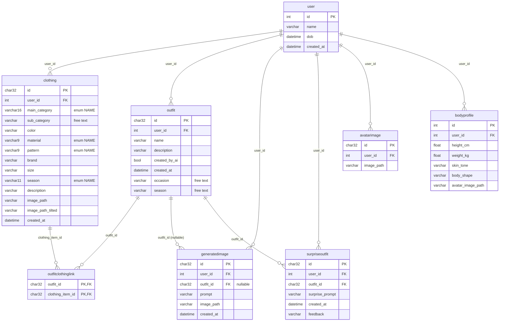
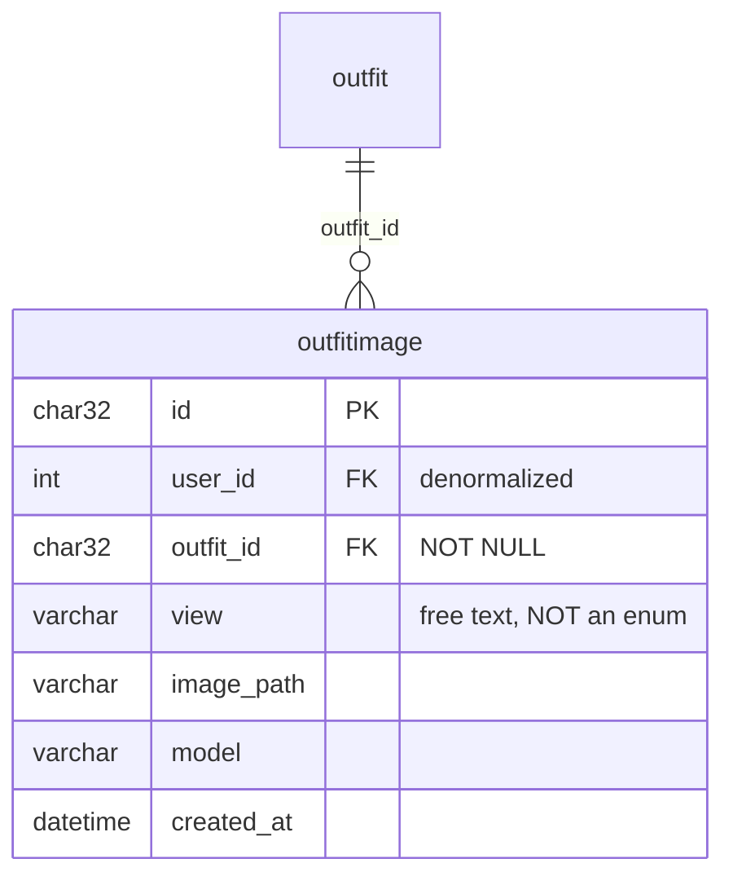
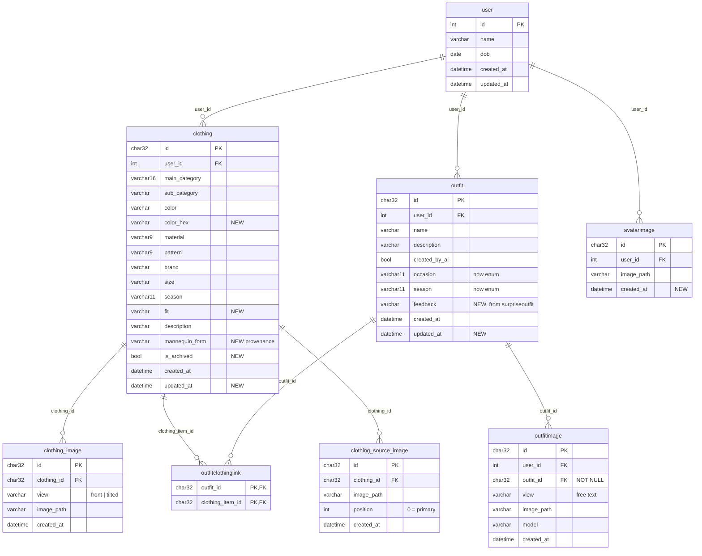

# Closet Muse — Database Audit & Persistence Plan

> **Purpose:** a self-contained handoff document. A new Copilot session should be able to
> read only this file and continue the work without re-deriving the analysis.
>
> **Status:** PLAN — Phase 1 implemented and verified (2026-11-11). Phases 2+ not started.
> **Audit date:** 2026-11-10, revised 2026-11-11.

---

## 1. Non-negotiable constraints

These were explicitly decided by the user. **Do not revisit them.**

| Constraint | Detail |
| --- | --- |
| **Single-user local** | `user` stays a 1-row seed table. No auth, no email uniqueness, no multi-user planning. `user_id=1` is hardcoded in the frontend. |
| **NO Alembic** | Alembic was added then removed. The user does not want a migration step on every app start. Use the idempotent-schema approach in Phase 2 instead. See `/memories/repo/schema.md`. |
| **`GeneratedImage` → `OutfitImage`** | Rename the table/model. Verified blast radius is 2 references. Table has 0 rows, so DROP + CREATE is safe — no data migration. |
| **`OutfitImage` has NO ordering column** | `view_order` was proposed and rejected. The frontend fetches all views and decides display order itself. Do not re-add an ordering column. |
| **`OutfitImage` drops these columns** | `latency_ms`, `seed`, `kind`, `aspect_ratio`, `prompt`, `view_order`. |
| **Wire up outfit history** | `Outfit` + `OutfitClothingLink` + `OutfitImage` must be written by the try-on flow. |
| **Clothing images live in child tables** | Polished output moves out of `clothing.image_path` / `image_path_tilted` into `clothing_image`; the user's source photos go in `clothing_source_image`. **Two tables, not one with a `kind` discriminator** — they have different shapes (`view` vs `position`) and different lifecycles. |

---

## 2. Current state — 8 tables, 3 genuinely live

All tables are defined in `src/closet_muse/db/models.py`.

| Table | Written by | Read by | Status |
| --- | --- | --- | --- |
| `user` | `seed.py`, `POST /users/` | `GET /users/{id}`, all FKs | ✅ LIVE |
| `clothing` | `POST /clothing/{user_id}` | list/counts/get/patch/delete, `/outfits/generate` | ✅ LIVE |
| `avatarimage` | `POST /users/{id}/avatar/` | `GET /users/{id}/avatar/` | ⚠️ API-only, no UI caller |
| `outfit` | **nothing** | `GET /outfits/{id}` only | ❌ DEAD |
| `outfitclothinglink` | **nothing** | `DELETE /clothing/item` (cleanup only) | ❌ DEAD |
| `generatedimage` | **nothing** | **nothing** | ❌ DEAD → rename |
| `surpriseoutfit` | **nothing** | **nothing** | ❌ DEAD |
| `bodyprofile` | **nothing** (only updated *if it already exists*) | avatar sync in `users.py` | ❌ DEAD (unreachable) |

### Purpose of each table (for context)

- **`user`** — the wardrobe owner. Holds `name` + `dob` only. A placeholder so `user_id=1` has a target.
- **`clothing`** — the wardrobe. One row per garment: `main_category` (enum name), optional `sub_category`, `color`, `material`, `pattern`, `brand`, `size`, `season`, `description`, plus two image filenames (front + three-quarter mannequin views) that Phase 7 moves into `clothing_image`. The only table with complete CRUD.
- **`avatarimage`** — history of uploaded avatar photos, one row per upload. Complete API, but unused by the UI and missing `created_at`.
- **`outfit`** — intended as a saved combination of garments. Never written; the only reader always 404s.
- **`outfitclothinglink`** — M:N join declaring which garments form an outfit. Never written.
- **`generatedimage`** — intended as the record of each AI-rendered image. Never written.
- **`surpriseoutfit`** — intended for the "Surprise Me" feature. Its consumer is a `pass` stub.
- **`bodyprofile`** — intended body measurements. Unreachable dead code, superseded by the generated model images in `assets/avatar/` + `settings.model_image_views`.

---

## 3. Current ER diagram (as built)

---

## 4. Findings

### Critical
1. **Orphaned files.** `POST /outfits/generate` calls `storage.save_image(...)` for each of 3 model views and **discards the returned filename**. Result: 47 orphan PNGs in `var/storage/generated/` with zero DB rows. No history, no re-view, no garbage collection.
2. **`create_all()` cannot add columns.** Every new field currently needs a manual `ALTER TABLE` or `make clean`. This is the #1 friction source and blocks every subsequent phase.

### Correctness
3. **No FK enforcement.** SQLite defaults to `PRAGMA foreign_keys=OFF` and nothing turns it on, so all `REFERENCES` clauses are decorative. That's why `delete_clothing_item` hand-deletes link rows.
4. **No indexes** except PK autoindexes. `outfitclothinglink`'s PK is `(outfit_id, clothing_item_id)`, so the delete path filtering on `clothing_item_id` full-scans. Every `WHERE user_id = ?` full-scans.
5. **No WAL / `busy_timeout`.** `check_same_thread=False` is set, but concurrent Streamlit + FastAPI writes can still hit `database is locked`.
6. **`AvatarImage` has no `created_at`** → `GET /users/{id}/avatar/` uses `avatar[-1]`, relying on rowid order.
7. **`BodyProfile` sync in `users.py` is unreachable** — it does `select(...).first()` then writes only `if profile is not None`, which is never true since no endpoint creates a row.

### Modeling
8. **`Outfit.occasion` / `Outfit.season` are free-text `Optional[str]`** while `enums.Occasion` and `enums.Season` already exist and are unused.
9. **`User.dob` is `datetime`**, should be `date`. No `updated_at` on any table.
10. **`Clothing` gaps:** no `updated_at`, `is_archived`, `color_hex` (the docstring mentions hex), `fit`, or provenance (`mannequin_form`).
11. **Source upload photos are discarded** — `POST /images/polish/` reads the uploads into memory, sends them to OpenRouter, and drops them. Only the polished mannequin images survive, so the user's original photos are gone forever and an item can never be re-polished with a different mannequin form. Fixed by Phase 7.
12. **"Surprise Me" is unimplemented** — `generate_surprise_outfit()` in `frontend/views/generate_outfit.py` is a literal `pass` stub.

### Observation
13. **Enum columns store the enum *name*** (`VARCHAR(16)` → `"ONE_PIECE"`, `VARCHAR(9)` → `"POLYESTER"`, `VARCHAR(11)` → `"ALL_SEASONS"`). Fine, but raw SQL and any future analytics see names, not `.value`. Document it.
14. **`response.json()["usage"]` is available and thrown away** in the notebook — free token/cost telemetry that is currently discarded. (Noted, not planned.)

---

## 5. Target schema

### Verdicts

| Table | Verdict | Reason |
| --- | --- | --- |
| `user` | **Keep, fix** | Retype `dob` to `date`; add `updated_at`. |
| `clothing` | **Keep, extend** | Add `updated_at`, `color_hex`, `fit`, `is_archived`, `mannequin_form`; move `image_path` / `image_path_tilted` into `clothing_image`. |
| `outfit` | **Keep, wire up** | Retype `occasion`/`season` to enums; add `feedback`, `updated_at`. |
| `outfitclothinglink` | **Keep, wire up** | Add `ON DELETE CASCADE` + index on `clothing_item_id`. |
| `outfitimage` | **Rename + wire up** | From `generatedimage`. New column set (below). |
| `surpriseoutfit` | **DROP** | Its `feedback` field moves to `outfit`. |
| `bodyprofile` | **DROP (defer)** | Unreachable. Re-add when personalization is real. |
| `avatarimage` | **Keep, fix** | Add `created_at`; order by it. |
| `clothing_image` | **ADD (required)** | Polished output, moved out of `clothing.image_path` / `image_path_tilted`. One row per view. |
| `clothing_source_image` | **ADD (required)** | The user's uploaded photos, currently discarded. Enables re-polishing later. |

### `OutfitImage` — final shape

**Six columns.** This is settled; do not add back what was removed.

**Kept:** `id`, `user_id`, `outfit_id`, `view`, `image_path`, `model`, `created_at`.

**Removed by user, with rationale:**
- `prompt` — `_build_tryon_prompt()` derives it deterministically from the linked clothing rows, so it is reconstructible. *Trade-off:* editing or deleting a garment permanently loses the ability to reproduce that historical look exactly. Accepted, because this is history, not a regeneration feature.
- `seed`, `aspect_ratio` — global `settings` values, not per-row facts.
- `kind` — `OutfitImage` is try-on only. Polish output is persisted in `clothing_image` (Phase 7), a different table, so no discriminator is needed here.
- `view_order` — the frontend fetches all views and decides order itself.

**Kept deliberately — `model`:** `settings.image_model_tryon` changes over time, so the model that actually rendered a row **cannot** be re-derived later. Cheapest possible provenance; this is the one field that must persist.

**Constraints:**
- `outfit_id` is `NOT NULL` — an "outfit image" with no outfit is a contradiction.
- `UNIQUE(outfit_id, view)` — one image per view per outfit. Guards against a retry or double-submit silently creating duplicate `center` images, which is a realistic failure mode given the current code path writes files with no DB guard.
- Indexes on `(user_id)` and `(outfit_id)`.

### Why `view` is free text, not an enum

The views are already config-driven: `settings.model_image_views` is `{"left": ..., "center": ..., "right": ...}` — arbitrary string keys mapping to file paths. Nothing in the DB needs to know that `left` means anything.

This mirrors the existing `clothing.sub_category` precedent (`Optional[str]` precisely so adding a sub-category needs no migration — see `/memories/repo/categories.md`). Adding `back`, `closeup`, `detail`, or `side` tomorrow means updating the settings dict and nothing else.

**No lookup table.** A `view` table only earns its keep when the set of views is *user-managed* data — uploadable, renameable, per-user. Yours is a fixed developer-curated set that ships with the code. A table would add a join and an insert-on-startup for no benefit.

### Ordering without `view_order` — implement in the frontend

`SELECT * FROM outfitimage WHERE outfit_id = ?` returns rows in **no guaranteed order**. Since `UNIQUE(outfit_id, view)` guarantees one row per view, the frontend already has what it needs:

1. Fetch rows, index them into a dict by `view`.
2. Iterate `settings.model_image_views` in its declared order, pulling matching rows.
3. Append any row whose `view` isn't in that dict (a newly added view, or one since removed from settings).

This is the **same pattern `display_look_panel()` already uses** — it does `names = [name for name in view_names if name in generated]` then `names = names or list(generated)` as fallback. The existing carousel logic survives the switch from in-memory ZIP to DB rows with almost no change.

### Target ER diagram

---

## 6. Implementation plan

Execute in order. Phases 1–2 are prerequisites for everything else.

### Phase 1 — Engine hardening *(no schema change; unblocks all later phases)* — ✅ DONE

**File:** `src/closet_muse/db/engine.py`
- Add a `PRAGMA foreign_keys=ON` connect listener (via `sqlalchemy.event.listens_for(engine, "connect")`).
- Add `PRAGMA journal_mode=WAL` and `PRAGMA busy_timeout=5000`.
- Keep `connect_args={"check_same_thread": False}`.

**File:** `src/closet_muse/api/deps.py`
- Add `session.rollback()` in the `finally` of `session_dep()`, wrapped so a rollback on an already-closed session cannot raise.

**Implemented 2026-11-11.** The listener is `_sqlite_pragmas` in `db/engine.py`. Verified:
`PRAGMA foreign_keys` → `1`, `journal_mode` → `wal`, `busy_timeout` → `5000`; an orphan
`clothing` insert now raises `IntegrityError: FOREIGN KEY constraint failed`;
`PRAGMA foreign_key_check` is clean on the existing 14-row DB; the create → read → delete
API round-trip still works with the new rollback in place.

### Phase 2 — Idempotent schema evolution *(the enabler for every later phase)*

**File:** `src/closet_muse/db/engine.py`
- Add `ensure_columns()`: for each table in `SQLModel.metadata.sorted_tables`, read `PRAGMA table_info(<table>)`, diff against the model's columns, and issue `ALTER TABLE ... ADD COLUMN` for anything missing.
- Derive the SQLite type from the SQLModel column type; emit `NULL`-able adds only (SQLite cannot add `NOT NULL` without a default).
- Call it from `create_db_and_tables()` immediately after `SQLModel.metadata.create_all(engine)`.
- Also add a `DROP TABLE IF EXISTS` cleanup list here (used in Phase 6).

This **replaces the manual `ALTER TABLE` ritual** documented in the README and `/memories/repo/schema.md`, and respects the no-Alembic decision.

### Phase 2b — Rename `generatedimage` → `outfitimage`

**File:** `src/closet_muse/db/models.py`
- Rename `class GeneratedImage` → `class OutfitImage`.
- Update the `__all__` list.
- `get_generated_image()` in `api/routers/outfits.py` is a *route handler name*, not the model — it is unaffected by the rename. Leave it (or rename it to `get_outfit_image` for clarity).

Table has 0 rows, so `DROP TABLE IF EXISTS generatedimage` in the Phase 6 cleanup list is sufficient.

### Phase 3 — Constraints & indexes *(depends on 1, 2)*

**File:** `src/closet_muse/db/models.py`
- Add `Index` declarations: `clothing(user_id)`, `clothing(user_id, main_category)`, `outfit(user_id)`, `outfitimage(user_id)`, `outfitimage(outfit_id)`, `avatarimage(user_id)`, `outfitclothinglink(clothing_item_id)`.
- Add `ondelete="CASCADE"` to `outfitclothinglink`'s FKs now that enforcement is on.

> **Caveat:** indexes and constraints **cannot** be added by `ALTER TABLE` on an existing SQLite table. Either create them with explicit `CREATE INDEX IF NOT EXISTS` statements in `create_db_and_tables()`, or accept that they only appear after a fresh DB (`make clean`). Recommend the former — it keeps the no-migration promise.

### Phase 4 — Wire up outfit persistence *(depends on 1, 2, 3)*

**File:** `src/closet_muse/api/routers/outfits.py` — `generate_outfit()`
- Before generating, create an `Outfit` row (`user_id`, `created_by_ai=True`).
- Insert one `OutfitClothingLink` per selected clothing item.
- For each view, **capture the filename returned by `storage.save_image(...)`** (currently discarded) and insert an `OutfitImage` row with `view`, `image_path`, `model=settings.image_model_tryon`.
- Return the `outfit_id` alongside the ZIP — e.g. in a response header (`X-Outfit-Id`), since the body is a binary ZIP.
- The whole thing must be transactional: if generation fails, do not leave a half-written outfit.

**New endpoints:**
- `GET /outfits/{user_id}/history` — list saved outfits.
- `GET /outfits/{outfit_id}/images` — the `OutfitImage` rows for one outfit.

> **Routing gotcha:** `GET /outfits/{outfit_id}` already exists. Registering `/outfits/{user_id}/history` is fine (different path shape), but keep `/outfits/image/{filename}` above `/outfits/{outfit_id}` as it is today, or FastAPI will try to parse `image` as a UUID.

### Phase 5 — Column extensions *(depends on 2)*

**`clothing`:** add `color_hex`, `fit`, `mannequin_form`, `is_archived`, `updated_at`.
- Populate `mannequin_form` from the onboarding form so an item can be re-polished or debugged later.
- **No `garment_type` column.** The onboarding form's "garment type" *is* `main_category` (it is the `WomenClothingMainCategory` selectbox), so storing it again would duplicate an existing column. `main_category` is the single source of truth.
- The two image columns (`image_path`, `image_path_tilted`) are **not** touched here — Phase 7 moves them into `clothing_image`.

**`outfit`:** retype `occasion` / `season` to `enums.Occasion` / `enums.Season`; add `feedback`, `updated_at`.

**`avatarimage`:** add `created_at`; change `GET /users/{id}/avatar/` to `ORDER BY created_at DESC LIMIT 1` instead of `avatar[-1]`.

**`user`:** retype `dob` to `date`; add `updated_at`.

### Phase 6 — Drop dead tables + storage GC *(depends on 3, 4)*

**File:** `src/closet_muse/db/models.py`
- Remove `SurpriseOutfit` and `BodyProfile` (classes + `__all__`).

**File:** `src/closet_muse/db/engine.py`
- Add to the cleanup list: `DROP TABLE IF EXISTS surpriseoutfit`, `bodyprofile`, `generatedimage`.

**File:** `src/closet_muse/api/routers/users.py`
- Delete the unreachable `BodyProfile` sync block in `upload_avatar`.

**File:** `src/closet_muse/api/routers/clothing.py`
- Once CASCADE is on, the manual `OutfitClothingLink` cleanup in `delete_clothing_item` becomes redundant. Keep it (harmless, defensive) or remove it — but verify CASCADE actually fires first.

**New:** `scripts/gc_storage.py` (or a `make gc` target in the `Makefile`)
- List files in `var/storage/generated/` (and other buckets) whose names match no `outfitimage.image_path` / `clothing_image.image_path` / `clothing_source_image.image_path` / `avatarimage.image_path`.
- Delete them. This reclaims the 47 existing orphans.
- Use `--dry-run` by default.

### Phase 7 — Clothing image tables *(depends on 1, 2, 3)*

Two new child tables. **Not one table with a `kind` discriminator** — the two kinds have
different shapes (`view` vs `position`) and different lifecycles, and a discriminator would
make every query filter on it.

#### 7a — `clothing_image` (polished output)

Replaces the two columns `clothing.image_path` (front) and `clothing.image_path_tilted`
(three-quarter). One row per view, so a third view needs no schema change.

**File:** `src/closet_muse/db/models.py`
- New `ClothingImage`: `id` (uuid PK), `clothing_id` (FK `clothing.id`, `ondelete="CASCADE"`),
  `view` (str, free text — `"front"` / `"tilted"`, mirroring `MANNEQUIN_VIEWS`),
  `image_path`, `created_at`.
- `UNIQUE(clothing_id, view)` — one polished image per view per item.
- Index on `clothing_id`.
- Add to `__all__`.

#### 7b — `clothing_source_image` (the user's uploads)

**File:** `src/closet_muse/db/models.py`
- New `ClothingSourceImage`: `id` (uuid PK), `clothing_id` (FK `clothing.id`,
  `ondelete="CASCADE"`), `image_path`, `position` (int, `0` = primary), `created_at`.
- Index on `clothing_id`.
- Add to `__all__`.

**File:** `src/closet_muse/settings.py`
- New `storage_bucket_clothing_source: str = "clothing_source"`.

#### 7c — DTOs (the compatibility layer)

**File:** `src/closet_muse/domain/schemas.py`
- `ClothingBase` **loses** `image_path` and `image_path_tilted` — it becomes pure attributes.
  This is what removes them from the `clothing` table, since `Clothing` inherits it.
- New `ClothingImageRead` (`view`, `image_path`) and `ClothingImageCreate` (same).
- New `ClothingSourceImageRead` (`image_path`, `position`).
- New `ClothingRead(ClothingBase)` — adds `id`, `user_id`, `created_at`,
  `images: list[ClothingImageRead]`, `source_images: list[ClothingSourceImageRead]`, **plus
  computed `image_path` / `image_path_tilted`** resolved from `images` by `view`.
- New `ClothingCreate(ClothingBase)` — adds `images: list[ClothingImageCreate]` and
  `source_image_paths: list[str]`.

> **Why the computed fields matter.** `frontend/views/edit_collection.py:90`,
> `frontend/views/generate_outfit.py:133,157` and `src/closet_muse/api/routers/outfits.py:39,45`
> all read `item["image_path"]` / `item["image_path_tilted"]`. Keeping them on `ClothingRead`
> means **none of those four call sites change**. This is the main risk-reducer in the phase.

> **Gotcha:** `edit_collection.py` does `ClothingBase(**item)` and `outfits.py` does
> `ClothingBase(**item.model_dump())`. Once the response carries `images` / `source_images`,
> those calls must become `ClothingBase.model_validate(item)` (or filter keys explicitly).
> Do not rely on Pydantic silently ignoring extras.

#### 7d — Router

**File:** `src/closet_muse/api/routers/clothing.py`
- `add_clothing_item` takes `ClothingCreate`; after committing the `Clothing` row, insert the
  `ClothingImage` rows and one `ClothingSourceImage` per path (`position=index`), all in the
  same transaction.
- `list_clothing` / `get_clothing_item` return `ClothingRead` with both child collections
  eagerly loaded.
- `delete_clothing_item` deletes the child rows and their files from both buckets before
  deleting the item (defensive, mirroring the existing `OutfitClothingLink` cleanup).
- New `GET /clothing/item/{clothing_id}/images` → `list[ClothingImageRead]`.
- New `GET /clothing/item/{clothing_id}/source-images` → `list[ClothingSourceImageRead]`.

**File:** `src/closet_muse/api/routers/outfits.py`
- Read the front/tilted polished images from `clothing_image` instead of the two columns.

#### 7e — Frontend

**File:** `frontend/api_utils.py`
- `add_clothing_item(..., source_images: list[FileLike] | None = None)`: upload the polished
  views and each source photo, then send `images` + `source_image_paths` in the payload.
- New `fetch_clothing_images(clothing_id)` / `fetch_clothing_source_images(clothing_id)`.

**File:** `frontend/views/onboard_wardrobe.py`
- Pass `source_images=list(st.session_state.onboard_uploader)` on save. `_upload_signature()`
  already guarantees the previews match the current uploads, so the photos are still valid.

#### 7f — Backfill the existing rows

**New:** `scripts/migrate_clothing_images.py` (or a `make migrate-images` target)
- For every `clothing` row with a non-null `image_path`, insert a `clothing_image` row with
  `view="front"`; likewise `image_path_tilted` → `view="tilted"`.
- Idempotent: skip a `(clothing_id, view)` pair that already exists.
- **Manual target, not called from `create_db_and_tables()`** — consistent with the
  no-migration-on-startup constraint.
- The legacy columns **stay in the table**, marked deprecated. SQLite cannot drop a column
  without a table rebuild, and `ensure_columns()` only ever adds, so nothing fights this.

#### 7g — GC

**File:** `scripts/gc_storage.py`
- The known-files set gains `clothing_image.image_path` and
  `clothing_source_image.image_path`; scan the new `clothing_source` bucket too.

### Phase 8 — Docs
- Update the "Database schema" section of `README.md`: remove the manual `ALTER TABLE` instructions, document `ensure_columns()`, the enum-name storage convention, and the FK/WAL settings.
- Document the two image tables, the `clothing_source` bucket, and the deprecated legacy columns.
- Update `/memories/repo/schema.md` with the same.
- Update `/memories/repo/categories.md` if the `view` vocabulary changes (see open questions).

---

## 7. Files affected

| File | Change |
| --- | --- |
| `src/closet_muse/db/models.py` | Rename `generatedimage`→`outfitimage`; drop `SurpriseOutfit`, `BodyProfile`; add `ClothingImage` + `ClothingSourceImage`; new columns; indexes; CASCADE |
| `src/closet_muse/db/engine.py` | PRAGMAs; `ensure_columns()`; `CREATE INDEX IF NOT EXISTS`; `DROP TABLE` cleanup |
| `src/closet_muse/api/deps.py` | `rollback()` on error |
| `src/closet_muse/api/routers/outfits.py` | **Core fix** — persist `Outfit` + links + `OutfitImage`; new history endpoints; read polished images from `clothing_image` |
| `src/closet_muse/api/routers/users.py` | Remove dead `BodyProfile` sync; order avatars by `created_at` |
| `src/closet_muse/api/routers/clothing.py` | Write/read both image child tables; new `/images` + `/source-images` endpoints; delete child files |
| `src/closet_muse/domain/schemas.py` | `ClothingBase` loses the two image fields; add `ClothingRead` / `ClothingCreate` / `ClothingImageRead` / `ClothingImageCreate` / `ClothingSourceImageRead`; `color_hex`/`fit` |
| `src/closet_muse/domain/enums.py` | `Occasion` / `Season` become the source of truth for `outfit` |
| `src/closet_muse/settings.py` | New `storage_bucket_clothing_source` |
| `frontend/api_utils.py` | Surface `outfit_id` from `generate_outfit`; add history fetchers; upload source photos; new image fetchers |
| `frontend/views/generate_outfit.py` | Consume persisted views; sort by known-order list; remove the `pass` stub |
| `frontend/views/onboard_wardrobe.py` | Pass the uploaded source photos on save |
| `scripts/migrate_clothing_images.py` | NEW — backfill `clothing_image` from the legacy columns |
| `scripts/gc_storage.py` | NEW — orphan cleanup, including both new tables |
| `Makefile` | Add `gc` and `migrate-images` targets |
| `README.md` | Update schema docs |

---

## 8. Verification

1. `make clean && make seed && make backend` — all tables create from scratch with the new columns and indexes.
2. **Regression test for the old pain:** add a throwaway field to `Clothing`, restart the backend *without* `make clean`, and confirm `ensure_columns()` adds it automatically.
3. `sqlite3 var/closet_muse.db "PRAGMA foreign_keys;"` → expect `1`. `PRAGMA journal_mode;` → expect `wal`.
4. `sqlite3 var/closet_muse.db ".indexes clothing"` → expect the new indexes.
5. Generate an outfit in the UI, then verify: one `outfit` row, N `outfitclothinglink` rows, 3 `outfitimage` rows with distinct `view` values, and every filename in `var/storage/generated/` has a DB row.
6. Delete a clothing item belonging to a saved outfit → the link row disappears via CASCADE (no manual cleanup).
7. Run the GC script → deletes only pre-existing orphans, leaves newly-persisted files alone.
8. `sqlite3 var/closet_muse.db ".tables"` → `surpriseoutfit`, `bodyprofile`, `generatedimage` are gone; `clothing_image` and `clothing_source_image` exist.
9. **Image tables:** onboard an item with 3 photos → 1 `clothing_image` (`front`) + 1 (`tilted`) + 3 `clothing_source_image` rows with `position` 0/1/2, and 3 files in `var/storage/clothing_source/`.
10. **Backward compatibility:** `GET /clothing/{user_id}` still returns `image_path` and `image_path_tilted` (computed), so the gallery, the selection tray and the edit dialog render unchanged.
11. **Try-on still works:** generate an outfit → the request receives both polished views read from `clothing_image`.
12. **Cascade:** delete the item → both child tables' rows are gone and every file (polished + source) is deleted.
13. **Backfill:** run `make migrate-images` on the existing DB → the 15 files in `var/storage/clothing/` become `clothing_image` rows; re-running is a no-op.
14. **Extraction unchanged:** `POST /images/attributes/` response contains no image keys.

---

## 9. Open questions

Recorded, not yet answered. Proceed with the recommendation unless the user says otherwise.

1. **Keep the denormalized `user_id` on `OutfitImage`?**
   It is derivable via `outfit.user_id`, and `outfit_id` is `NOT NULL`. **Recommendation: keep.** Denormalizing a single immutable FK on a small table is a normal, low-risk call, and it lets the history query be a flat scan instead of a join.

2. **Rename the view values semantically?**
   `settings.model_image_views` currently uses positional names: `left` / `center` / `right`. Positional names describe where an image sits in *today's* carousel — a UI detail, and the one thing guaranteed to change. **Recommendation: switch to semantic names** (`front` / `three_quarter` / `profile`) before writing any rows, because view strings are **permanent once persisted**. This also aligns with the polish flow, which already uses `front` / `tilted`.

3. **Migrate `occasion` / `season` to enum columns?**
   Retyping requires a data rewrite if any rows exist. Currently zero rows, so it is free — but only if done before Phase 4 starts writing outfits. **Recommendation: do it in Phase 5, before wiring persistence.**

4. **Keep the computed `image_path` / `image_path_tilted` on `ClothingRead` permanently?**
   They exist so the four existing readers (`edit_collection.py:90`, `generate_outfit.py:133,157`, `outfits.py:39,45`) need no changes. **Recommendation: keep them permanently** — they are a cheap, stable convenience for the two most common lookups, and removing them later would be a breaking API change for no gain. The alternative is to drop them once the frontend reads `images[]` directly.

5. **Should the backfill run automatically?**
   **Recommendation: no** — keep it a manual `make migrate-images` target, consistent with the no-migration-on-startup constraint. Calling it from `create_db_and_tables()` would reintroduce exactly the startup migration step the user rejected.

---

## 10. Out of scope

Multi-user/auth, Postgres migration, soft-delete UI (the `is_archived` column is added but not wired), any analytics/warehouse layer, and persisting polish output as `OutfitImage`.

Also out of scope for Phase 7: a re-polish UI (re-running polish from the stored source photos — the data now exists, the feature does not), and physically dropping the deprecated `clothing.image_path` / `image_path_tilted` columns (SQLite needs a table rebuild; they are harmless once nothing reads them).

---

## 11. Repo gotchas to respect

Carried over from `/memories/repo/schema.md`:

- **`create_all()` does NOT add columns** to an existing table. Phase 2 exists to fix this.
- **SQLite stores UUID PKs WITHOUT dashes** (e.g. `aec9d236a56846bebd0cdb77c8f4874a`). Raw `sqlite3` queries must use the dashless form; the API accepts dashed.
- **SQLite FK enforcement is OFF by default**, which is why manual link cleanup exists. Phase 1 turns it on.
- **Streamlit/settings hot-reload:** `settings.py` is imported at module load, so editing it does not hot-reload in a running Streamlit process. Restart `make frontend` after changing settings.
